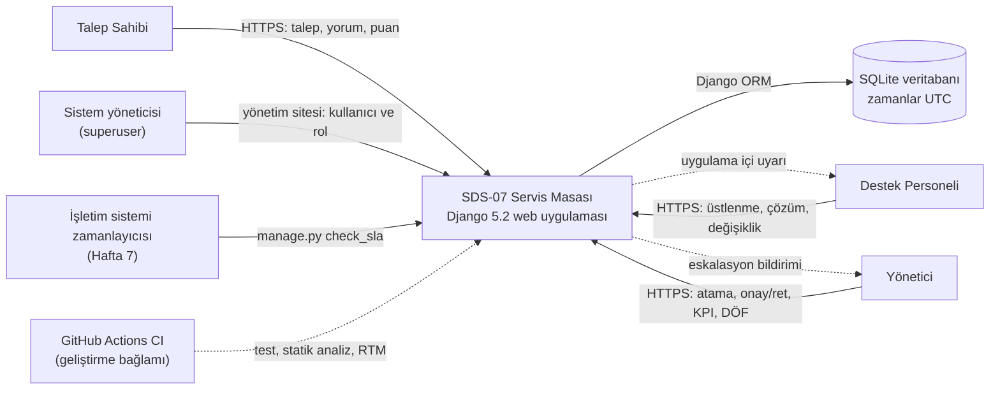
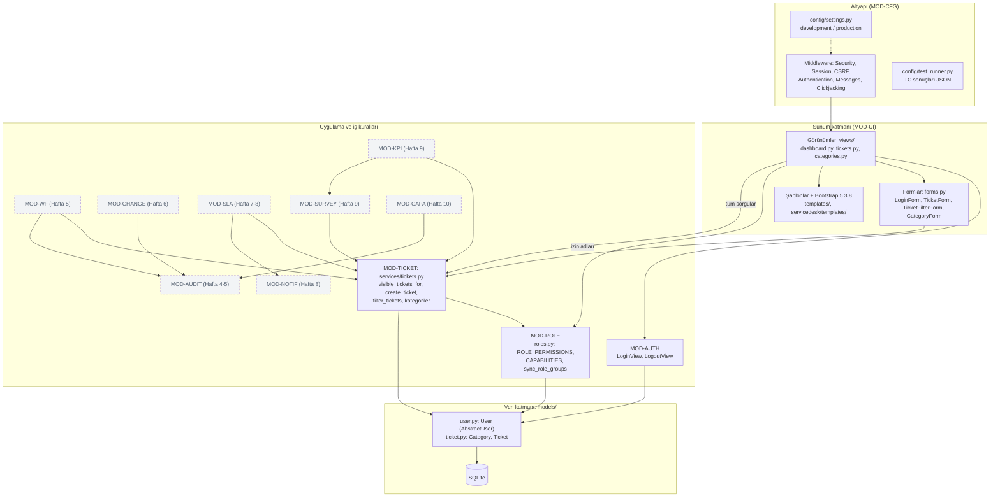
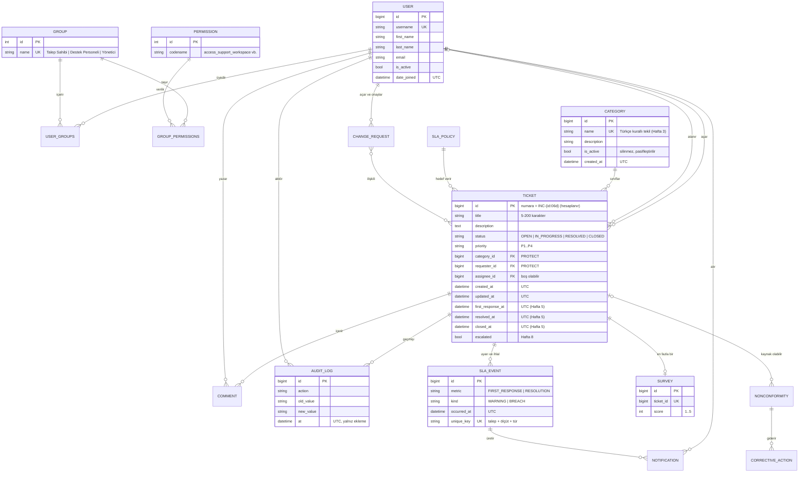
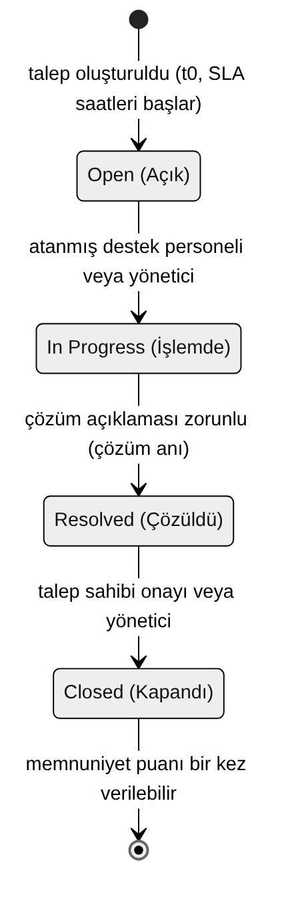
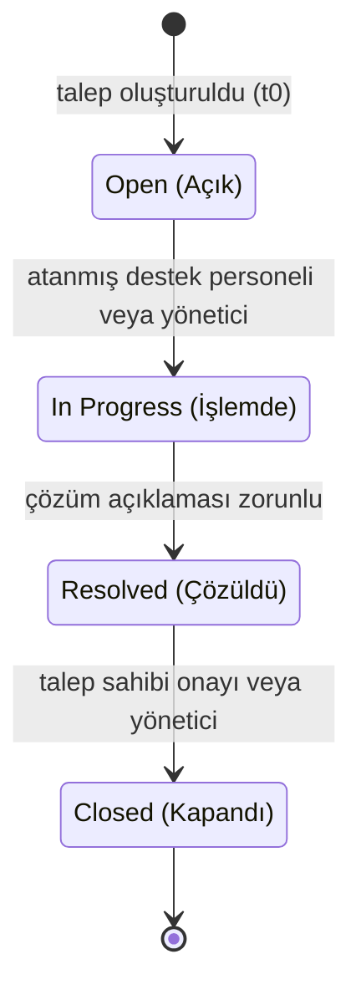
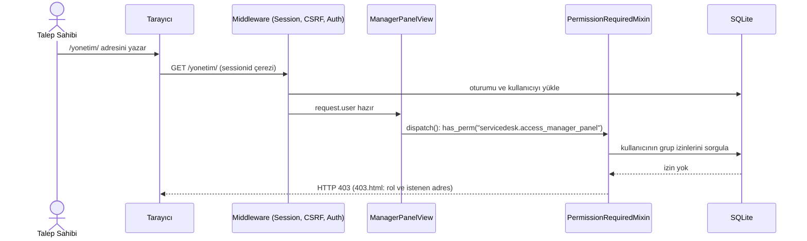
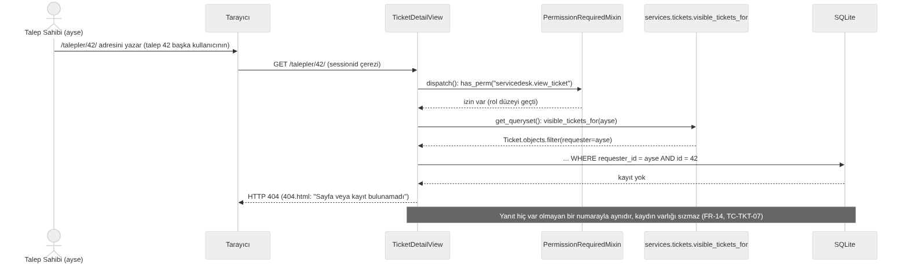
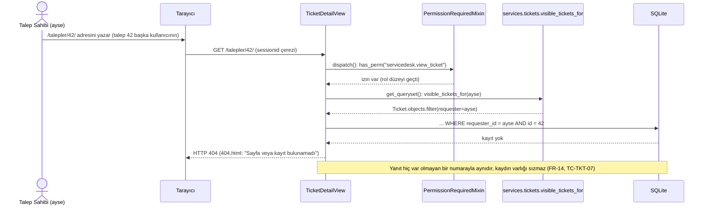

# SDS-07 Yazılım Tasarım Tanımı (SDD) - mimari taslak

| Alan | Değer |
|---|---|
| Doküman kimliği | SDS07-SDD |
| Sürüm | 0.3 (taslak) |
| Tarih | 26.11.2026 |
| Durum | Taslak: Hafta 1-4'te uygulanmış yapı + Faz 5 için planlanan yapı (proje Faz 5'te biter, KRR-18) |
| Hazırlayan | Burak Nigiz (2100002062) |
| Dayanak | IEEE 1016-2009 tasarım görünümleri (IEEE SA'da Inactive-Reserved; ders kapsamında kullanılıyor) |

## Revizyon geçmişi

| Sürüm | Tarih | Yazar | Değişiklik |
|---|---|---|---|
| 0.1 | 30.10.2026 | Burak Nigiz | Hafta 2: bağlam, bileşim/mantıksal, bilgi, durum dinamikleri ve etkileşim görünümleri; karar günlüğü KRR-01..KRR-10 (KRR-01..KRR-05 Hafta 1 kararlarıdır) |
| 0.2 | 30.10.2026 | Burak Nigiz | Hafta 3: `models/`, `services/`, `views/` paketleri; MOD-TICKET bileşeni ve arayüz sözleşmeleri; Category ve Ticket bilgi görünümü; kayıt düzeyi erişim etkileşimi (404); mimari kural testleri; karar günlüğü KRR-11..KRR-15 |
| 0.3 | 26.11.2026 | Burak Nigiz | Hafta 4: Comment ve TicketEvent bilgi görünümü; `services/assignment.py`, `services/comments.py`, `services/audit.py`; `views/ticket_actions.py`; işlem geçmişi bütünlük kuralları; karar günlüğü KRR-16..KRR-18 |

Diyagram kaynakları `docs/diagrams/*.mmd` dosyalarındadır (Mermaid). PNG/SVG çıktıları aynı klasördedir ve `mmdc` ile yeniden üretilebilir.

## 1. Paydaşlar, kaygılar ve görünümler

| Paydaş | Kaygı (concern) | Karşılayan görünüm |
|---|---|---|
| Öğretim elemanı, proje sahibi | Sistem sınırı nedir, kimlerle etkileşir? | Bağlam (§3) |
| Geliştirici (Burak Nigiz) | Kod nerede, hangi modül neyi yapar, nasıl genişler? | Bileşim (§4) |
| Geliştirici ve test sorumlusu (tek kişi) | Bir istek nasıl işlenir, yetki nerede denetlenir? | Mantıksal (§5), Etkileşim (§8) |
| Kalite sorumlusu, denetçi | Hangi veriler tutulur, zamanlar nasıl saklanır, kayıtlar değiştirilebilir mi? | Bilgi (§6) |
| Destek personeli, yönetici | Talep hangi durumlardan geçer, kim geçirir? | Durum dinamikleri (§7) |
| Sistem yöneticisi | Nasıl kurulur ve güvenli yapılandırılır? | Bileşim (§4.3), INSTALL.md |

## 2. Tasarım özeti

- **Tek Django projesi, tek uygulama:** `config/` (proje ayarları) ve `servicedesk/` (uygulama). İç yapı MOD kimlikli modüllere ayrılır. Mikroservis, ayrı API veya SPA yoktur (KRR-01).
- **Sunucu tarafında üretilen arayüz:** Django Templates + Bootstrap 5.3.8 (yerel dosya).
- **Hazır Django altyapısı:** kullanıcı (`AbstractUser`), oturum, grup, izin, form, ORM ve yönetim sitesi.
- **Yetkilendirme:** Rol = Group, yetki = Permission; sunucuda `PermissionRequiredMixin` ile denetlenir. Kayıt bazlı kural Hafta 3'ten itibaren tek politika fonksiyonundadır (`services/tickets.py::visible_tickets_for`); liste ve ayrıntı sorguları yalnız bu fonksiyondan gelir (KRR-06, KRR-07).
- **Katmanlar (Hafta 3):** `views/` → `services/` → `models/`. Görünüm HTTP isteğini ve yetkiyi ele alır, iş kuralını servis fonksiyonuna bırakır. Kural, her test koşusunda kaynak kod üzerinde denetlenir (TC-ARCH-01, TC-ARCH-02; KRR-11).
- **Zaman:** UTC saklama, Europe/Istanbul gösterim (`USE_TZ=True`, `TIME_ZONE="Europe/Istanbul"`).

## 3. Bağlam görünümü (Context viewpoint)

Sistem dışında kalanlar: e-posta sunucusu, dizin hizmeti, harici izleme araçları (kapsam dışı). Kesik çizgili öğeler sonraki haftalarda veya geliştirme bağlamında yer alır.

## 4. Bileşim görünümü (Composition viewpoint)

### 4.1 Modül-dosya eşlemesi

| MOD | Sorumluluk | Dosyalar (Hafta 3 durumu) |
|---|---|---|
| MOD-CFG | Ayar profilleri, güvenlik, saat dilimi, test koşucusu | `config/settings.py`, `config/test_runner.py`, `config/urls.py` |
| MOD-AUTH | Giriş/çıkış, giriş formu | `config/urls.py` (LoginView/LogoutView), `servicedesk/forms.py`, `templates/registration/login.html` |
| MOD-ROLE | Roller, rol-izin matrisi, senkronizasyon, demo kullanıcılar | `servicedesk/roles.py`, `servicedesk/apps.py`, `servicedesk/models/user.py` (izin tanımları), `servicedesk/admin.py`, `servicedesk/management/commands/seed_demo_users.py` |
| MOD-UI | Şablonlar, gezinme, hata sayfaları, tema, panel | `templates/`, `servicedesk/templates/`, `servicedesk/views/dashboard.py`, `servicedesk/context_processors.py`, `static/css/app.css` |
| MOD-TICKET | Talep ve kategori modeli, kayıt bazlı erişim politikası, talep oluşturma, liste/filtre/sayfalama, kategori yönetimi | `servicedesk/models/ticket.py`, `servicedesk/services/tickets.py`, `servicedesk/views/tickets.py`, `servicedesk/views/categories.py`, `servicedesk/forms.py`, `servicedesk/text.py`, `servicedesk/templates/servicedesk/tickets/`, `.../categories/`, migration 0003 ve 0004 |
| MOD-WF, MOD-AUDIT, MOD-CHANGE, MOD-SLA, MOD-NOTIF, MOD-SURVEY, MOD-KPI, MOD-CAPA | Planlandı | İlgili haftada `models/`, `services/`, `views/` paketlerine yeni modül olarak eklenecek (NFR-16) |

### 4.2 Bileşen diyagramı

**Bağımlılık kuralları:** Görünümler iş kuralı içermez ve model yöneticilerine (`.objects`) doğrudan erişmez; servis fonksiyonlarını çağırır. Servisler görünümlere, şablonlara ve HTTP katmanına bağımlı değildir. Modeller servis ve görünüm katmanını içe aktarmaz. Her görünüm sınıfı oturum veya izin denetimi içerir. Bu kurallar Hafta 3'ten itibaren TC-ARCH-01 ve TC-ARCH-02 ile kaynak kod üzerinde otomatik denetlenir. MOD-AUDIT'e yazma yalnız servis katmanından yapılacaktır (Hafta 4-5).

### 4.3 Çalışma profilleri

| Profil | Etkinleştirme | DEBUG | SECRET_KEY | Çerezler | HTTPS |
|---|---|---|---|---|---|
| development | varsayılan | Açık | Sabit, yalnız yerel anahtar | Secure kapalı | Yok |
| production | `DJANGO_ENV=production` | Kapalı (açılamaz) | Ortam değişkeni zorunlu | Secure, HttpOnly | SSL yönlendirme, HSTS (3600 sn, ayarlanabilir) |

## 5. Mantıksal görünüm (Logical viewpoint)

İstek işleme zinciri (Hafta 2; Hafta 3'te talep sayfaları aynı zinciri kullanır):

1. **Middleware:** SecurityMiddleware → SessionMiddleware → CommonMiddleware → CsrfViewMiddleware → AuthenticationMiddleware → MessageMiddleware → XFrameOptionsMiddleware.
2. **URL çözümleme:** `config/urls.py` → `servicedesk/urls.py`.
3. **Erişim denetimi:** `LoginRequiredMixin` (panel) veya `PermissionRequiredMixin` (destek kuyruğu, yönetim paneli, talep ve kategori sayfaları). Oturum yoksa giriş sayfasına yönlendirilir; oturum var ama izin yoksa `PermissionDenied` → 403.
4. **Kayıt düzeyi (Hafta 3):** Talep görünümlerinin sorgu kümesi `visible_tickets_for(user)` fonksiyonundan gelir; görünmeyen kayıt için `DetailView` 404 döndürür.
5. **Bağlam:** `role_context` bağlam işlemcisi her şablona `role_label`, `current_role` ve `app_version` ekler; menü bağlantıları `perms` ile gösterilir.
6. **Şablon:** `base.html` + sayfa şablonu.

### 5.1 Arayüz sözleşmeleri (MOD-TICKET, `services/tickets.py`)

| İşlev | Girdi | Çıktı / kural | Kullanıldığı yer |
|---|---|---|---|
| `visible_tickets_for(user)` | Django kullanıcısı | `view_all_tickets` → tüm talepler; yalnız `view_ticket` → kendi talepleri; izin yok veya oturum yok → boş küme | Liste, ayrıntı, kuyruk, panel özeti |
| `filter_tickets(qs, filters)` | Sorgu kümesi, `TicketFilters` | Durum, öncelik, kategori, atanan (`none` = atanmamış) ile daraltır; asla genişletmez | Talep listesi |
| `create_ticket(...)` | talep sahibi, başlık, açıklama, kategori, öncelik | Pasif kategoriyi reddeder; `full_clean`; durum Open | Yeni talep görünümü |
| `open_queue(user)` | kullanıcı | Görünür ve Open talepler, en eskisi önce | Destek kuyruğu |
| `status_counts(user)` | kullanıcı | Süreç sırasıyla durum sayıları | Panel özeti |
| `active_categories()` / `all_categories()` | - | Etkin kategoriler / talep sayısıyla tüm kategoriler | Talep formu / filtre ve kategori yönetimi |
| `create_category(...)`, `set_category_active(...)` | ad, açıklama / kategori, etkin mi | Türkçe kurallı tekil ad (`Category.clean`); kategori silinmez | Kategori yönetimi |
| `status_steps(status)` | durum kodu | Süreç şeridi için geçildi / şu an / sırada | Talep ayrıntısı |

### 5.2 Arayüz sözleşmeleri (MOD-ROLE)

| İşlev | Girdi | Çıktı | Kullanıldığı yer |
|---|---|---|---|
| `get_role(user)` | Django kullanıcısı | `Role` veya `None` | Bağlam işlemcisi, panel |
| `capabilities_for(role)` | `Role` veya `None` | Yetenek satırları listesi | Panel |
| `sync_role_groups(using)` | Veritabanı takma adı | `SyncResult` listesi (oluşturuldu, +izin, -izin) | `post_migrate`, demo komutu, testler |
| `ROLE_PERMISSIONS` | - | rol anahtarı → izin kümesi | Senkronizasyon, testler |

### 5.3 Yetki politikası (403 ve 404 kuralı)

- **Rol düzeyi (Hafta 2):** Sayfa veya işlem role kapalıysa 403 döner (FR-09).
- **Kayıt düzeyi (Hafta 3, uygulandı):** Kullanıcının görme hakkı olmayan kayıt için 404 döner; yanıt var olmayan numarayla aynıdır, böylece kayıt numarası tahminiyle varlık bilgisi sızmaz (FR-14, TC-TKT-07). Ayrıntı adresine POST, kaydın varlığından bağımsız olarak 405 döner. Yorum (Hafta 4), işlem (Hafta 5) ve anket (Hafta 9) adresleri aynı politikayı kullanacak.
- Her iki denetim de sunucudadır; şablondaki koşullar yalnız gösterim içindir (FR-10).

## 6. Bilgi görünümü (Information viewpoint)

Hafta 3'te veritabanında bulunan tablolar: `servicedesk_user`, `servicedesk_category`, `servicedesk_ticket`, `auth_group`, `auth_permission`, `servicedesk_user_groups`, `auth_group_permissions`, `django_content_type`, `django_session`, `django_admin_log`. Başlangıç kategorileri veri migration'ıyla gelir (0004: Donanım, Yazılım, Ağ ve bağlantı, Hesap ve erişim, Diğer). Diğer varlıklar planlıdır; uygulanacakları hafta SRS §2.2'dedir.

### 6.1 Veri bütünlüğü kuralları

| Kural | Uygulama yeri | Gereksinim |
|---|---|---|
| Zaman damgaları UTC | `USE_TZ=True`; tüm `DateTimeField` alanları | NFR-05 |
| Talep başına en fazla bir anket | `SURVEY.ticket_id` tekil kısıt | FR-32 |
| Aynı SLA olayı için tek kayıt | `SLA_EVENT` (talep, ölçüt, tür) tekil kısıt | FR-30 |
| İşlem geçmişi yalnız eklenir | `TicketEvent.save()` ikinci kayıtta ve `delete()` her zaman `ImmutableEventError` verir; yönetim sitesinde ekleme/değiştirme/silme kapalı; kayıt işlemle aynı veritabanı işleminde yazılır (KRR-16, Hafta 4) | FR-20 |
| Grup adları sabit | Rol matrisi kodda; `migrate` sonrası eşitlenir | FR-06 |
| Talep numarası benzersiz | Birincil anahtardan türetilir: `INC-{id:06d}` (KRR-12) | FR-12 |
| Talep durumu formdan değiştirilemez | `status` alanı `editable=False`; yeni talep Open başlar | FR-12, FR-18 |
| Kategori silinmez | `on_delete=PROTECT`; yönetim sitesinde silme kapalı; pasifleştirme (KRR-14) | FR-15 |
| Kategori adı tekil | Veritabanında `unique`; Türkçe büyük/küçük harf farkı `Category.clean` ile denetlenir (RSK-21) | FR-15 |
| Atama yalnız Destek Personeline | `services/assignment.py::agents()` (rol grubu + etkin); servis ve form aynı kümeyi kullanır (Hafta 4) | FR-16 |
| Aynı talebi iki kişi üzerine alamaz | Üzerine alma işlem içinde talebi kilitleyerek (`select_for_update`) yeniden okur ve atananı denetler (Hafta 4) | FR-16 |
| Kapanmış talep değişmez | Yorum, atama ve öncelik servisleri Closed talebi reddeder (Hafta 4) | FR-17, FR-16 |
| Yorum ve geçmiş silinmez | `Comment` ve `TicketEvent` talebe `PROTECT` ile bağlı; yönetim sitesinde silme kapalı (Hafta 4) | FR-17, FR-20 |

### 6.2 Saklama ve gizlilik

Kullanıcı hakkında yalnız kullanıcı adı, ad, soyad ve e-posta tutulur (NFR-12). Demo ve test verilerinde gerçek kişi verisi kullanılmaz. Saklama süresi ve KVKK aydınlatma metni açık konudur (SRS AK-08).

## 7. Durum dinamikleri görünümü (State dynamics)

Hafta 3'te talepler yalnız Open durumunda oluşur; geçişler Hafta 5'te durum makinesiyle eklenecek. Tanımsız geçişler (ör. Open → Closed) sunucuda reddedilecektir (FR-18). Değişiklik kaydı durumları: Onay Bekliyor → Onaylandı / Reddedildi → Uygulandı (Başarılı / Başarısız-geri alındı). Düzeltici faaliyet durumları: Açık → Analiz → Faaliyet → Etkinlik Kontrolü → Kapalı (Etkili değil → Faaliyet).

## 8. Etkileşim görünümü

### 8.1 Doğrudan adresle role kapalı sayfaya erişim (403, Hafta 2)

### 8.2 Başkasına ait talebe doğrudan adresle erişim (404, Hafta 3)

## 9. Karar günlüğü

| Kimlik | Karar | Gerekçe | Alternatif |
|---|---|---|---|
| KRR-01 | Tek Django projesi, tek uygulama, modüler iç yapı (Hafta 1) | Proje talimatı; tek kişilik ekip için basit dağıtım ve migration yönetimi | Çok uygulamalı yapı: modüller arası migration bağımlılığı artar |
| KRR-02 | Baştan özel `User` modeli (`AbstractUser`) (Hafta 1) | Django belgeleri yeni projelerde önerir; sonradan geçiş zordur | Yerleşik `auth.User`: ileride alan ekleme zorlaşır |
| KRR-03 | development/production profilleri; üretimde güvensiz ayarla başlamama (Hafta 1) | Hatalı dağıtımı erken yakalama (NFR-04) | Tek ayar dosyası + elle değişiklik |
| KRR-04 | Test sonuçlarını TC kimliğiyle JSON'a yazan koşucu ve RTM üretici (Hafta 1) | RTM'de gerçek sonuç; elle sonuç yazımını önleme | Elle güncellenen RTM: kanıt kuralına aykırı olabilir |
| KRR-05 | Haftalık paketler: gereksinim ve testlerde `week` sütunu, RTM'de `--week N`, kanıtlar `docs/evidence/hafta-NN/` (Hafta 1) | Her hafta ayrı teslim ve ayrı rapor; planlanan ile doğrulananın ayrı görünmesi | Yalnız iki haftalık dönem etiketi: haftalık ilerleme görünmez |
| KRR-06 | Rol = Group, yetki = Permission; matris kodda; `post_migrate` ile eşitleme (Hafta 2) | Tek doğruluk kaynağı, tekrarlanabilir kurulum, test edilebilirlik | Yalnız grup adına göre denetim: grup yeniden adlandırılınca yetki kırılır |
| KRR-07 | Rol düzeyinde 403, kayıt düzeyinde 404 (Hafta 2) | Kullanıcıya açıklama; kayıtların varlığını sızdırmama | Her durumda 403: kayıt numarası tahmini mümkün olur |
| KRR-08 | Bootstrap ve yazı tipi yerel dosyadan (Hafta 2) | Çevrimdışı demo; dış CDN'ye bağımlılık yok | CDN: internet gerektirir |
| KRR-09 | Çıkış yalnız POST (Hafta 2) | Django 5'te LogoutView varsayılanı; CSRF ile korunur | GET ile çıkış: CSRF ile oturum kapatma saldırısına açık |
| KRR-10 | SLA kontrolü için yönetim komutu + işletim sistemi zamanlayıcısı (Hafta 2'de kararlaştırıldı, Hafta 7'de uygulanacak) | Ek servis (Celery/Redis) gerekmez; tekrarlanabilir ve test edilebilir | Celery beat: kapsamı büyütür |
| KRR-11 | `models/`, `services/`, `views/` paketleri; bağımlılık yönü views → services → models; kural AST tabanlı testlerle denetlenir (Hafta 3) | NFR-16; kural belgede kalmaz, her koşuda doğrulanır | Yalnız belgede kural: sapma fark edilmez; ayrı Django uygulamaları: KRR-01'e aykırı |
| KRR-12 | Talep numarası birincil anahtardan türetilir (`INC-000123`), ayrı alan tutulmaz (Hafta 3) | Benzersizliği veritabanı garanti eder; eşzamanlı kayıtta çakışma olmaz | Ayrı sayaç alanı veya tablosu: yarış durumu ve ek kilit gerekir |
| KRR-13 | Öncelik talep formunda talep sahibince seçilir; AK-03 için geçici karar (Hafta 3) | FR-12 metni; talep sahibinin aciliyet bilgisi kaybolmaz. Hafta 4'te destek personeli değiştirebilecek ve işlem geçmişine yazılacak | Önceliği yalnız destek personeli belirler |
| KRR-14 | Kategori silinmez, pasifleştirilir (`PROTECT` + yönetim sitesinde silme kapalı) (Hafta 3) | Eski taleplerin sınıflaması ve izlenebilirlik bozulmaz (ISO 9001:2026 8.5.2) | Silip talepleri "Diğer"e taşımak: geçmiş değişir |
| KRR-15 | Tarayıcı testlerinde sunucu `DJANGO_DEBUG=0` ve `runserver --insecure` ile çalışır (Hafta 3) | Kullanıcı üretimdeki özel hata sayfalarını görür (RSK-23) | DEBUG açık: 404 için Django hata ayıklama sayfası görünür, test gerçek deneyimi ölçmez |
| KRR-16 | İşlem geçmişinin değiştirilemezliği uygulama düzeyinde sağlanır: model `save()`/`delete()` engeli, salt okunur yönetim sitesi, yazımın tek modülden (`services/audit.py`) yapılması (Hafta 4) | FR-20'nin "arayüzden düzenlenemez/silinemez" koşulunu karşılar; SQLite'ta ek araç gerektirmez; testle doğrulanır (TC-AUD-02, mutasyon M13) | Veritabanı tetikleyicisi: veritabanına bağımlı, taşınabilirliği azaltır; doğrudan SQL erişimine karşı koruma kapsam dışı |
| KRR-17 | AK-03 kararı: talep sahibi önceliği talep açarken seçer; Destek Personeli ve Yönetici değiştirebilir; değişiklik işlem geçmişine yazılır (Hafta 4; KRR-13'ün yerine) | Talep sahibinin aciliyet bilgisi korunur, uzman değerlendirmesi izlenebilir biçimde uygulanır | Önceliği yalnız personel belirler: talep sahibinin bilgisi kaybolur |
| KRR-18 | Proje Faz 5'te (11.12.2026) biter: Faz 4 atama/yorum/işlem geçmişi, Faz 5 durum geçişleri + işlem geçmişi görünümü + final; FR-22..FR-37 ve NFR-13..NFR-15 gelecek çalışma (Hafta 4) | Kalan sürede çekirdek talep akışı uçtan uca, testli ve belgeli tamamlanır; yarım modül bırakılmaz | 25 gereksinimin tümünü iki faza sıkıştırmak: test ve kanıt kalitesi düşer |
