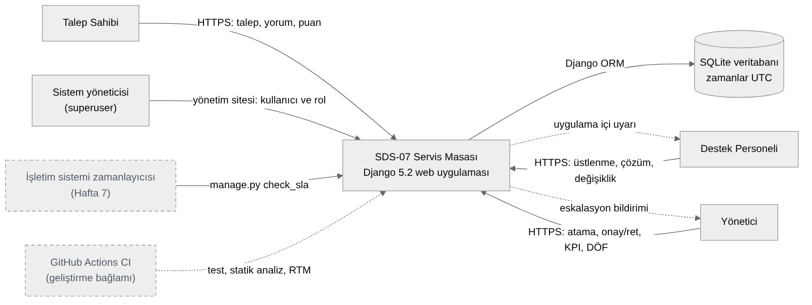
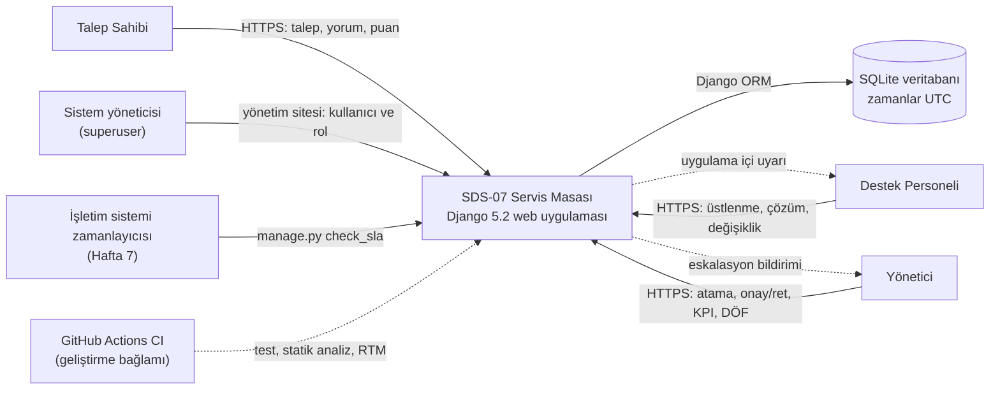
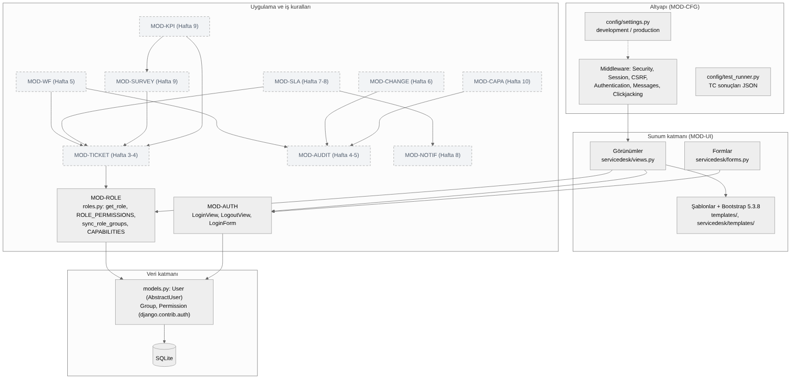
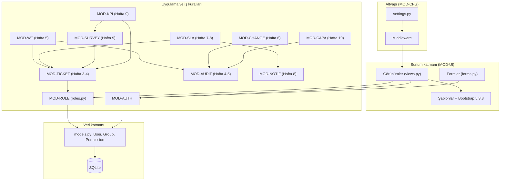
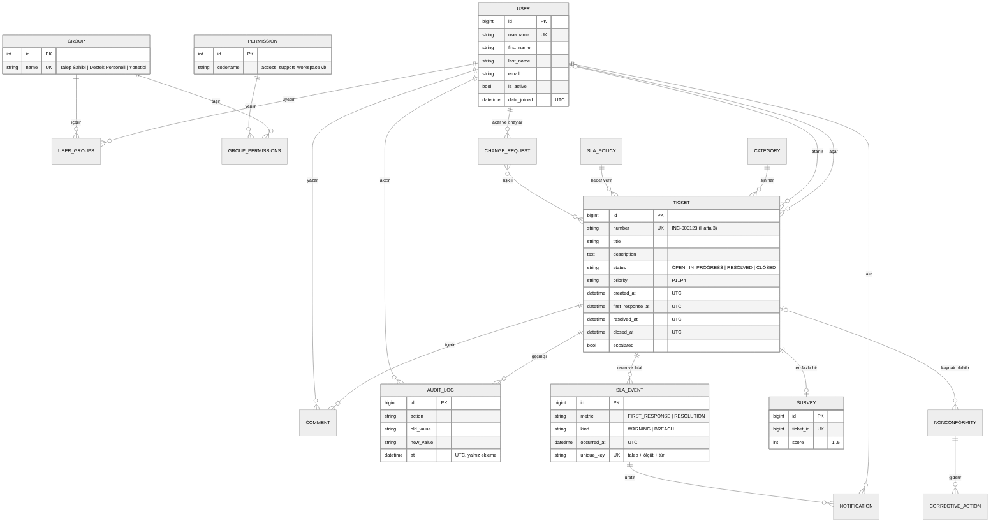
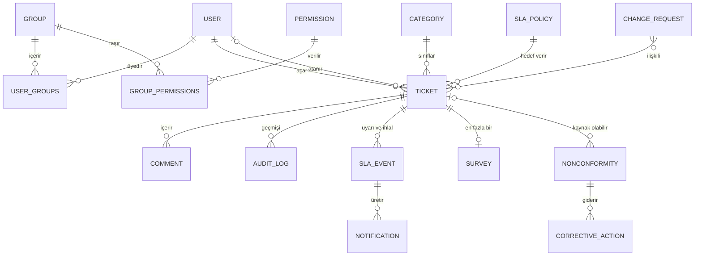
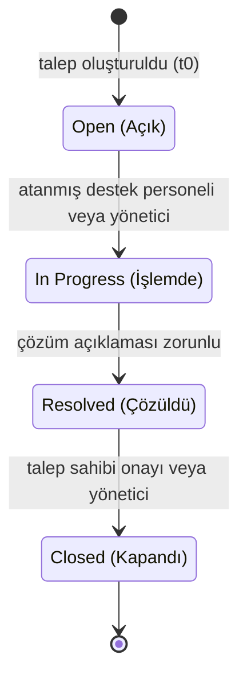
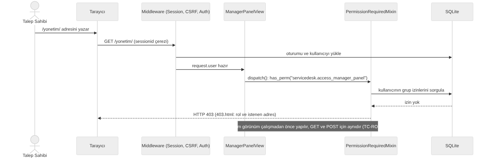
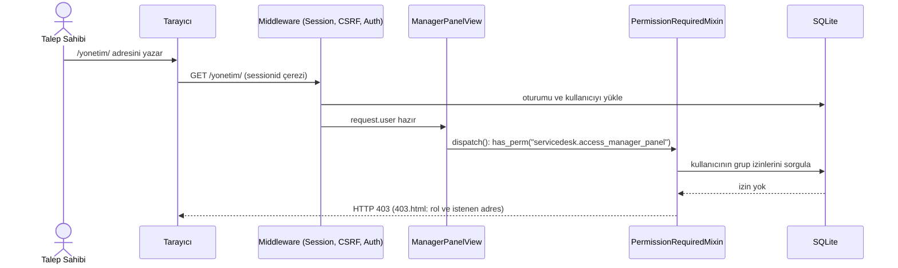

# SDS-07 Yazılım Tasarım Tanımı (SDD) - mimari taslak

| Alan | Değer |
|---|---|
| Doküman kimliği | SDS07-SDD |
| Sürüm | 0.1 (taslak) |
| Tarih | 30.10.2026 |
| Durum | Taslak: Hafta 1-2'de uygulanmış yapı + sonraki haftalar için planlanan yapı |
| Hazırlayan | Burak Nigiz (2100002062) |
| Dayanak | IEEE 1016-2009 tasarım görünümleri (IEEE SA'da Inactive-Reserved; ders kapsamında kullanılıyor) |

## Revizyon geçmişi

| Sürüm | Tarih | Yazar | Değişiklik |
|---|---|---|---|
| 0.1 | 30.10.2026 | Burak Nigiz | Hafta 2: bağlam, bileşim/mantıksal, bilgi, durum dinamikleri ve etkileşim görünümleri; karar günlüğü KRR-01..KRR-10 (KRR-01..KRR-05 Hafta 1 kararlarıdır) |

Diyagram kaynakları `docs/diagrams/*.mmd` dosyalarındadır (Mermaid). PNG/SVG çıktıları aynı klasördedir ve `mmdc` ile yeniden üretilebilir.

## 1. Paydaşlar, kaygılar ve görünümler

| Paydaş | Kaygı (concern) | Karşılayan görünüm |
|---|---|---|
| Öğretim elemanı, proje sahibi | Sistem sınırı nedir, kimlerle etkileşir? | Bağlam (§3) |
| Geliştirici (Burak Nigiz) | Kod nerede, hangi modül neyi yapar, nasıl genişler? | Bileşim (§4) |
| Geliştirici ve test sorumlusu (tek kişi) | Bir istek nasıl işlenir, yetki nerede denetlenir? | Mantıksal (§5), Etkileşim (§8) |
| Kalite sorumlusu, denetçi | Hangi veriler tutulur, zamanlar nasıl saklanır, kayıtlar değiştirilebilir mi? | Bilgi (§6) |
| Destek personeli, yönetici | Talep hangi durumlardan geçer, kim geçirir? | Durum dinamikleri (§7) |
| Sistem yöneticisi | Nasıl kurulur ve güvenli yapılandırılır? | Bileşim (§4.3), INSTALL.md |

## 2. Tasarım özeti

- **Tek Django projesi, tek uygulama:** `config/` (proje ayarları) ve `servicedesk/` (uygulama). İç yapı MOD kimlikli modüllere ayrılır. Mikroservis, ayrı API veya SPA yoktur (KRR-01).
- **Sunucu tarafında üretilen arayüz:** Django Templates + Bootstrap 5.3.8 (yerel dosya).
- **Hazır Django altyapısı:** kullanıcı (`AbstractUser`), oturum, grup, izin, form, ORM ve yönetim sitesi.
- **Yetkilendirme:** Rol = Group, yetki = Permission; sunucuda `PermissionRequiredMixin` ile denetlenir. Kayıt bazlı kurallar Hafta 3'ten itibaren sorgu filtreleriyle (policy fonksiyonları) uygulanacak (KRR-06, KRR-07).
- **Zaman:** UTC saklama, Europe/Istanbul gösterim (`USE_TZ=True`, `TIME_ZONE="Europe/Istanbul"`).

## 3. Bağlam görünümü (Context viewpoint)

Sistem dışında kalanlar: e-posta sunucusu, dizin hizmeti, harici izleme araçları (kapsam dışı). Kesik çizgili öğeler sonraki haftalarda veya geliştirme bağlamında yer alır.

## 4. Bileşim görünümü (Composition viewpoint)

### 4.1 Modül-dosya eşlemesi

| MOD | Sorumluluk | Dosyalar (Hafta 2 durumu) |
|---|---|---|
| MOD-CFG | Ayar profilleri, güvenlik, saat dilimi, test koşucusu | `config/settings.py`, `config/test_runner.py`, `config/urls.py` |
| MOD-AUTH | Giriş/çıkış, giriş formu | `config/urls.py` (LoginView/LogoutView), `servicedesk/forms.py`, `templates/registration/login.html` |
| MOD-ROLE | Roller, rol-izin matrisi, senkronizasyon, demo kullanıcılar | `servicedesk/roles.py`, `servicedesk/apps.py`, `servicedesk/models.py` (izin tanımları), `servicedesk/admin.py`, `servicedesk/management/commands/seed_demo_users.py` |
| MOD-UI | Şablonlar, gezinme, hata sayfaları, tema | `templates/`, `servicedesk/templates/`, `servicedesk/views.py`, `servicedesk/context_processors.py`, `static/css/app.css` |
| MOD-TICKET, MOD-WF, MOD-AUDIT, MOD-CHANGE, MOD-SLA, MOD-NOTIF, MOD-SURVEY, MOD-KPI, MOD-CAPA | Planlandı | Hafta 3'te `servicedesk/models/`, `servicedesk/services/`, `servicedesk/views/` paketlerine bölünecek (NFR-16) |

### 4.2 Bileşen diyagramı

**Bağımlılık kuralları:** Görünümler iş kuralı içermez; servis fonksiyonlarını çağırır. Servisler şablonlara bağımlı değildir. MOD-AUDIT'e yazma yalnız servis katmanından yapılır. Döngüsel bağımlılık yasaktır (Hafta 3'ten itibaren inceleme maddesi, NFR-16).

### 4.3 Çalışma profilleri

| Profil | Etkinleştirme | DEBUG | SECRET_KEY | Çerezler | HTTPS |
|---|---|---|---|---|---|
| development | varsayılan | Açık | Sabit, yalnız yerel anahtar | Secure kapalı | Yok |
| production | `DJANGO_ENV=production` | Kapalı (açılamaz) | Ortam değişkeni zorunlu | Secure, HttpOnly | SSL yönlendirme, HSTS (3600 sn, ayarlanabilir) |

## 5. Mantıksal görünüm (Logical viewpoint)

İstek işleme zinciri (Hafta 2):

1. **Middleware:** SecurityMiddleware → SessionMiddleware → CommonMiddleware → CsrfViewMiddleware → AuthenticationMiddleware → MessageMiddleware → XFrameOptionsMiddleware.
2. **URL çözümleme:** `config/urls.py` → `servicedesk/urls.py`.
3. **Erişim denetimi:** `LoginRequiredMixin` (panel) veya `PermissionRequiredMixin` (destek kuyruğu, yönetim paneli). Oturum yoksa giriş sayfasına yönlendirilir; oturum var ama izin yoksa `PermissionDenied` → 403.
4. **Bağlam:** `role_context` bağlam işlemcisi her şablona `role_label`, `current_role` ve `app_version` ekler; menü bağlantıları `perms` ile gösterilir.
5. **Şablon:** `base.html` + sayfa şablonu.

### 5.1 Arayüz sözleşmeleri (MOD-ROLE)

| İşlev | Girdi | Çıktı | Kullanıldığı yer |
|---|---|---|---|
| `get_role(user)` | Django kullanıcısı | `Role` veya `None` | Bağlam işlemcisi, panel |
| `capabilities_for(role)` | `Role` veya `None` | Yetenek satırları listesi | Panel |
| `sync_role_groups(using)` | Veritabanı takma adı | `SyncResult` listesi (oluşturuldu, +izin, -izin) | `post_migrate`, demo komutu, testler |
| `ROLE_PERMISSIONS` | - | rol anahtarı → izin kümesi | Senkronizasyon, testler |

### 5.2 Yetki politikası (403 ve 404 kuralı)

- **Rol düzeyi (Hafta 2):** Sayfa veya işlem role kapalıysa 403 döner (FR-09).
- **Kayıt düzeyi (Hafta 3):** Kullanıcının görme hakkı olmayan kayıt için 404 döner; böylece kayıt numarası tahminiyle varlık bilgisi sızmaz (FR-14).
- Her iki denetim de sunucudadır; şablondaki koşullar yalnız gösterim içindir (FR-10).

## 6. Bilgi görünümü (Information viewpoint)

Hafta 2'de veritabanında bulunan tablolar: `servicedesk_user`, `auth_group`, `auth_permission`, `servicedesk_user_groups`, `auth_group_permissions`, `django_content_type`, `django_session`, `django_admin_log`. Diğer varlıklar planlıdır; uygulanacakları hafta SRS §2.2'dedir.

### 6.1 Veri bütünlüğü kuralları

| Kural | Uygulama yeri | Gereksinim |
|---|---|---|
| Zaman damgaları UTC | `USE_TZ=True`; tüm `DateTimeField` alanları | NFR-05 |
| Talep başına en fazla bir anket | `SURVEY.ticket_id` tekil kısıt | FR-32 |
| Aynı SLA olayı için tek kayıt | `SLA_EVENT` (talep, ölçüt, tür) tekil kısıt | FR-30 |
| İşlem geçmişi yalnız eklenir | Yönetim sitesinde salt okunur; model düzeyinde güncelleme/silme engeli | FR-20 |
| Grup adları sabit | Rol matrisi kodda; `migrate` sonrası eşitlenir | FR-06 |

### 6.2 Saklama ve gizlilik

Kullanıcı hakkında yalnız kullanıcı adı, ad, soyad ve e-posta tutulur (NFR-12). Demo ve test verilerinde gerçek kişi verisi kullanılmaz. Saklama süresi ve KVKK aydınlatma metni açık konudur (SRS AK-08).

## 7. Durum dinamikleri görünümü (State dynamics)

Tanımsız geçişler (ör. Open → Closed) sunucuda reddedilir (FR-18). Değişiklik kaydı durumları: Onay Bekliyor → Onaylandı / Reddedildi → Uygulandı (Başarılı / Başarısız-geri alındı). Düzeltici faaliyet durumları: Açık → Analiz → Faaliyet → Etkinlik Kontrolü → Kapalı (Etkili değil → Faaliyet).

## 8. Etkileşim görünümü: doğrudan adresle yetkisiz erişim

## 9. Karar günlüğü

| Kimlik | Karar | Gerekçe | Alternatif |
|---|---|---|---|
| KRR-01 | Tek Django projesi, tek uygulama, modüler iç yapı (Hafta 1) | Proje talimatı; tek kişilik ekip için basit dağıtım ve migration yönetimi | Çok uygulamalı yapı: modüller arası migration bağımlılığı artar |
| KRR-02 | Baştan özel `User` modeli (`AbstractUser`) (Hafta 1) | Django belgeleri yeni projelerde önerir; sonradan geçiş zordur | Yerleşik `auth.User`: ileride alan ekleme zorlaşır |
| KRR-03 | development/production profilleri; üretimde güvensiz ayarla başlamama (Hafta 1) | Hatalı dağıtımı erken yakalama (NFR-04) | Tek ayar dosyası + elle değişiklik |
| KRR-04 | Test sonuçlarını TC kimliğiyle JSON'a yazan koşucu ve RTM üretici (Hafta 1) | RTM'de gerçek sonuç; elle sonuç yazımını önleme | Elle güncellenen RTM: kanıt kuralına aykırı olabilir |
| KRR-05 | Haftalık paketler: gereksinim ve testlerde `week` sütunu, RTM'de `--week N`, kanıtlar `docs/evidence/hafta-NN/` (Hafta 1) | Her hafta ayrı teslim ve ayrı rapor; planlanan ile doğrulananın ayrı görünmesi | Yalnız iki haftalık dönem etiketi: haftalık ilerleme görünmez |
| KRR-06 | Rol = Group, yetki = Permission; matris kodda; `post_migrate` ile eşitleme (Hafta 2) | Tek doğruluk kaynağı, tekrarlanabilir kurulum, test edilebilirlik | Yalnız grup adına göre denetim: grup yeniden adlandırılınca yetki kırılır |
| KRR-07 | Rol düzeyinde 403, kayıt düzeyinde 404 (Hafta 2) | Kullanıcıya açıklama; kayıtların varlığını sızdırmama | Her durumda 403: kayıt numarası tahmini mümkün olur |
| KRR-08 | Bootstrap ve yazı tipi yerel dosyadan (Hafta 2) | Çevrimdışı demo; dış CDN'ye bağımlılık yok | CDN: internet gerektirir |
| KRR-09 | Çıkış yalnız POST (Hafta 2) | Django 5'te LogoutView varsayılanı; CSRF ile korunur | GET ile çıkış: CSRF ile oturum kapatma saldırısına açık |
| KRR-10 | SLA kontrolü için yönetim komutu + işletim sistemi zamanlayıcısı (Hafta 2'de kararlaştırıldı, Hafta 7'de uygulanacak) | Ek servis (Celery/Redis) gerekmez; tekrarlanabilir ve test edilebilir | Celery beat: kapsamı büyütür |
